# Awesome Creative Cloud Storage ☁️🎨

  

  
  
  
  
  
  

---

> 🚀 A curated collection of top SaaS platforms and open-source self-hosted solutions for creative asset management, enterprise file sync & share (EFSS), cloud backups, and high-performance collaboration workflows.

---

## 📑 Table of Contents

- [📊 Sector Overview & Market Dynamics](#-sector-overview--market-dynamics)
- [☁️ SaaS / Hosted Platforms](#️-saas--hosted-platforms)
- [💻 Open-Source GitHub Projects](#-open-source-github-projects)
- [🤝 How to Contribute](#-how-to-contribute)
- [☕ Support](#-support)
- [📈 Star History](#-star-history)
- [⚖️ Disclaimer](#️-disclaimer)

---

## 📊 Sector Overview & Market Dynamics

The global Enterprise File Sync & Share (EFSS) and Creative Cloud Storage market is estimated at **$11.5 billion in 2026** and is projected to expand at an **18.2% CAGR** toward **$26 billion by 2031**, fueled by exponential creative asset volumes (4K/8K video, 3D renderings, RAW photography) and hybrid remote production pipelines. The market is **moderately concentrated** at the enterprise suite layer—dominated by mega-caps like Microsoft and Google who bundle cloud drives into office suites—yet remains **highly fragmented and competitive** across specialized creative niches where zero-knowledge security (Tresorit, Sync.com), workflow DAM integration (Box, Adobe), and self-hosted data sovereignty (Nextcloud, Immich, Seafile) command loyal followings.

---

## ☁️ SaaS / Hosted Platforms

Below is a breakdown of prominent commercial and enterprise creative cloud storage platforms, sorted in descending order by parent company scale (Market Cap / Enterprise Valuation).

| Product | Scale (Valuation / Market Cap) | Description | Pricing | Free Tier Limit |
| :--- | :--- | :--- | :--- | :--- |
| **[Microsoft OneDrive for Business](https://www.microsoft.com/en-us/microsoft-365/onedrive/online-cloud-storage)** | ~$3.1 Trillion (Market Cap) | Cloud storage deeply integrated with Microsoft 365, Office apps, and Teams collaboration. | **$5.00/user/month** (Business Plan 1, 1 TB/user); **$10.00/user/month** (Plan 2, unlimited storage per user). | **5 GB free** permanently for personal accounts. Business plans offer a **30-day free trial** (up to 25 licenses). |
| **[Google Drive Enterprise](https://workspace.google.com/)** | ~$2.1 Trillion (Market Cap) | Cloud storage integrated with Google Workspace, Docs, Sheets, Meet, and Gemini AI. | **$6.00/user/month** (Workspace Business Starter, 30 GB/user pooled); **$12.00/user/month** (Business Standard, 2 TB/user pooled). | **15 GB free** permanently per Google account (shared across Drive, Gmail, Photos). Business plans include a **14-day free trial**. |
| **[Adobe Creative Cloud Storage](https://helpx.adobe.com/lu_en/business/enterprise/manage-storage-assets/manage-storage/adobe-storage-quota-and-limits.html)** | ~$220 Billion (Market Cap) | Cloud storage bundled with Creative Cloud apps, Lightroom, Document Cloud, and Adobe Express. Storage is pooled across organization licenses. | **$37.99/month** (Single App Business); **$89.99/user/month** (Creative Cloud All Apps for teams, 1 TB pooled storage per license). | **2 GB free** permanently with free Adobe ID membership. Paid plans include a **7-day free trial** with full creative app access and 100 GB storage. |
| **[Dropbox Business](https://www.dropbox.com/business/upgrade-account)** | ~$9.5 Billion (Market Cap) | Pioneer enterprise file sync, content collaboration, paper docs, and team creative workspace. | **$15.00/user/month** (Standard plan, 3 TB pooled team storage, min 3 users); **$24.00/user/month** (Advanced, 15 TB pooled). | **2 GB free** permanently for Dropbox Basic individual accounts. Business plans offer a **30-day free trial** with full team capabilities. |
| **[Box Enterprise](https://www.box.com/)** | ~$4.8 Billion (Market Cap) | Enterprise content management, cloud storage, compliance governance, and Box AI workflows. | **$15.00/user/month** (Business plan, unlimited storage, min 3 users); **$25.00/user/month** (Business Plus); **$35.00/user/month** (Enterprise). | **10 GB free** permanently for Box Individual accounts (250 MB single file upload limit). Business editions include a **14-day free trial**. |
| **[Egnyte](https://www.egnyte.com/)** | ~$1.6 Billion (Valuation) | Enterprise file sharing and hybrid cloud content governance platform tailored for life sciences and architecture/engineering/construction. | **$20.00/user/month** (Team plan, 1 TB storage, 1-10 users); **$22.00/user/month** (Business, 1 TB base + 10 GB/user). | No permanent free tier. Offers a **15-day free trial** with 1 TB shared storage and 5-user collaboration. |
| **[MEGA Corporate](https://mega.io/)** | ~$500 Million (Valuation) | Privacy-centric encrypted cloud storage with client-side zero-knowledge encryption and chat. | **$16.20/month** (Business plan, min 3 users, 3 TB base storage + $2.70/TB additional). | **20 GB free** permanently with achievement bonuses expanding capacity up to 50 GB. Business plans offer a **30-day free trial**. |
| **[pCloud Business](https://www.pcloud.com/)** | ~$250 Million (Valuation) | Secure Swiss-based cloud storage with virtual drive streaming and optional client-side encryption. | **$7.99/user/month** (pCloud Business, min 3 users, 1 TB/user); or **$219 one-time** (500 GB Lifetime) / **$499 one-time** (2 TB Lifetime). | **10 GB free** permanently for individual accounts (unlockable via introductory tasks). Business accounts offer a **30-day free trial** (up to 3 users). |
| **[Tresorit](https://tresorit.com/)** | ~$150 Million (Acquisition Valuation) | Swiss and EU-hosted end-to-end zero-knowledge encrypted cloud storage for high-security creative and legal assets. | **$14.50/user/month** (Business Standard, 1 TB encrypted storage per user, min 3 users); **$24.00/user/month** (Business Plus, 2 TB). | No permanent free tier. Offers a **14-day free trial** with full 1 TB encryption features and up to 10 users. |
| **[Sync.com](https://www.sync.com/)** | ~$100 Million (Valuation) | Private cloud storage featuring client-side end-to-end zero-knowledge encryption and unlimited file size transfers. | **$6.00/user/month** (Teams Standard, 1 TB storage per user); **$9.00/user/month** (Teams Unlimited, unlimited storage). | **5 GB free** permanently for Sync Starter individual accounts (basic sharing & encryption). Teams plans include a **30-day money-back trial**. |

---

## 💻 Open-Source GitHub Projects

Self-hosted cloud storage engines, peer-to-peer file synchronization daemons, and creative media backup suites, **ranked in descending order by GitHub_Stars**:

- **[Immich](https://github.com/immich-app/immich)**   
  High-performance self-hosted photo, video, and creative media management solution designed as a direct replacement for Google Photos and Adobe Lightroom web catalogs. Includes ML facial recognition, object detection, reverse geocoding, multi-user isolation, and real-time mobile background backup.

- **[Syncthing](https://github.com/syncthing/syncthing)**   
  Open-source peer-to-peer continuous file synchronization standard (MPL-2.0). Connects workstations, render nodes, and backup servers directly over TLS without passing through third-party cloud servers. Ideal for large production project files, RAW assets, and decentralizing local team storage.

- **[Rclone](https://github.com/rclone/rclone)**   
  The "Swiss Army knife" of cloud storage (MIT). Versatile command-line program to sync, transfer, encrypt, and mount files across 70+ cloud storage providers including S3, B2, Google Drive, OneDrive, and SFTP. Features virtual on-demand filesystem mounting (`rclone mount`) essential for creative media pipelines.

- **[Nextcloud Server](https://github.com/nextcloud/server)**   
  The flagship comprehensive self-hosted collaboration platform (AGPL-3.0). Serves as an open-source alternative to Dropbox and Box, featuring file sync and sharing, granular access control, external storage mounts, version history, Nextcloud Talk, and rich integrations with Collabora and OnlyOffice.

- **[File Browser](https://github.com/filebrowser/filebrowser)**   
  Lightweight, single-binary personal cloud and web file manager written in Go (Apache-2.0). Provides a clean, modern web interface to upload, download, preview audio/video/images, edit documents, and manage permissions over any existing server filesystem without database overhead.

- **[Ente Photos](https://github.com/ente-io/ente)**   
  End-to-end encrypted, zero-knowledge cloud storage and synchronization architecture for creative photo and video assets (AGPL-3.0). Features audited client-side cryptography, cross-platform clients (iOS, Android, macOS, Windows, Linux), and full self-hosting support.

- **[Seafile](https://github.com/haiwen/seafile)**   
  High-performance open-source file sync and sharing engine written in C/Python (AGPLv3). Employs Git-like block-level deduplication and delta sync, making it exceptionally fast for huge creative binary assets, design files, and video project folders. Features client-side encrypted libraries and the SeaDrive virtual file drive.

- **[SFTPGo](https://github.com/drakkan/sftpgo)**   
  Fully-featured and highly configurable event-driven file transfer and storage gateway supporting SFTP, HTTP/S (WebDAV/WebClient), and FTP/S with multi-tenant storage backends (S3, GCS, Azure Blob, local disk). Essential for automated ingestion of assets from studios and remote production teams.

- **[ownCloud Infinite Scale (oCIS)](https://github.com/owncloud/ocis)**   
  A complete microservices-based, cloud-native rewrite of ownCloud in Go (Apache-2.0). Eliminates traditional database bottlenecks via the EOS storage engine, introducing user-independent Spaces, enterprise audit logging, and OIDC authentication tailored for high-concurrency cloud native deployments.

- **[Pydio Cells](https://github.com/pydio/cells)**   
  Cloud-native enterprise file sharing and content collaboration platform (AGPL-3.0) written in Go with microservice architecture. Offers fine-grained attribute-based access control (ABAC), user-friendly Spaces, automated workflows, and S3-compliant distributed storage.

---

## 🤝 How to Contribute

Contributions are welcome to keep this directory updated!

1. 🍴 Fork the repository.
2. 🌿 Create a feature branch: `git checkout -b add-awesome-tool`.
3. 📝 Add your entry ensuring:
   - For SaaS: Include starting pricing, specific free tier limits, company scale, and official links.
   - For Open-Source: Include official repo link, Stars_Badge linking to stargazers, license, and primary capabilities.
4. 🚀 Commit your changes and submit a Pull Request with a clear description.

---

## ☕ Support

If you found this curated list helpful for your workflow, cloud infrastructure, or creative studio:

- ⭐ **Star this repository** to help others discover it!
- 🍴 **Fork it** to maintain your own custom list or contribute back.
- 📣 **Share it** with your engineering and design peers.
- ☕ Consider sponsoring or buying a coffee via the [Sponsor Dashboard](https://github.com/sponsors/ishandutta2007)!

---

## 📈 Star History

---

## ⚖️ Disclaimer

- This repository is a **community-curated index** and is not affiliated with or endorsed by Adobe, Microsoft, Google, Dropbox, Box, or any listed vendor.
- **Adobe Creative Cloud storage is not a standalone EFSS product**: it is bundled with Adobe Creative Cloud subscriptions and pooled at the organizational or account level.
- **Pricing and free tiers change frequently**: Always verify current limits, terms of service, and bandwidth quotas directly on vendor websites before planning enterprise deployments.
- **Self-hosting considerations**: Operating self-hosted solutions like Nextcloud, Seafile, or Immich requires independent server maintenance, storage backup strategies, and network security management.

---

  <b>Crafted for creative professionals, production studios, DevOps engineers, and self-hosting enthusiasts.</b>

